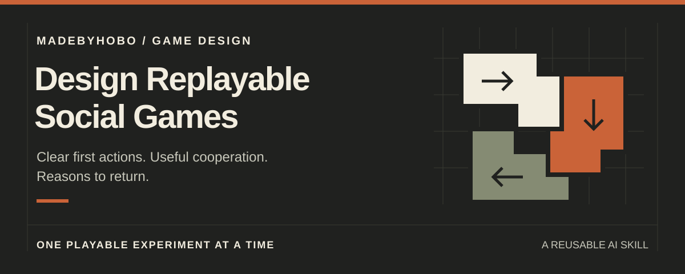

# Design Replayable Social Games

An AI skill for turning a game idea, a prototype review, or a pile of research into **one small, playable experiment**.

For indie developers, designers, and small teams building games people choose to return to. Start with what players actually do: understand the first action, make something theirs, contribute to each other, and see an outcome worth caring about.

**Keep the game's identity. Test the design. Respect the player.**

## Use it

The reusable instructions live in [SKILL.md](SKILL.md). No runtime, dependencies, or engine integration required.

- **With a skill-capable assistant:** add this repository's skill folder using your tool's supported skill workflow. Keep the relative file structure intact. Installation and invocation depend on your assistant.
- **With any other assistant:** provide the contents of `SKILL.md` alongside your game brief. Include the source notes only when you want their optional Roblox examples.
- **Without AI:** use the evaluation lenses and test checklist directly in a design review.

If your assistant supports named invocation, try:

> Use $design-replayable-social-games to review my two-player repair game. Players understand the tools but mostly work alone. Propose one small change that makes cooperation useful. Keep a viable solo path.

Or use a plain-language prompt:

> Apply this skill to my browser-game prototype. Our team has one week. Review the first session, label what you actually inspected, and choose one reversible improvement with a playtest plan. Don't implement it yet.

Research-only prompt:

> Separate documented mechanics, creator testimony, and hypotheses in this research. Suggest what might transfer to my game, what still needs verification, and one experiment worth trying.

## The workflow

1. **Ground the brief.** Establish players, devices, session shape, constraints, and evidence limits.
2. **Find the gap.** Review the first useful action, personal investment, meaningful cooperation, legible outcomes, connected progression, sustainable content, performance, and player respect.
3. **Choose one slice.** Rank no more than three opportunities. Pick the smallest reversible change that tests the real activity.
4. **Make it observable.** Define the hypothesis, playable behavior, comparison, counter-signals, and keep / revise / stop decision.

These are lenses, not a demand to add every feature. A solo game does not need multiplayer just to satisfy a checklist.

## What you get

A compact design brief with:

- The core promise and what the evidence can actually support
- Up to three opportunities, with confidence, cost, risk, and dependencies
- One playable slice and a concrete first-session sequence
- A test plan, acceptance checklist, guardrails, and open questions

See the [worked example: Shared Repair](examples/shared-repair.md) for the level of specificity to aim for. It is a fictional example, not a measured case study.

## Evidence, not a formula

This is a design framework, not a validated predictor of retention or a recipe for virality. Successful games can suggest hypotheses; they do not establish why a mechanic worked or whether it will transfer.

The [optional source notes](references/source-notes.md) link to Roblox's public documentation and a developer interview. The workflow is platform-neutral; discovery rules and engine guidance are not. Recheck time-sensitive claims before using them. No player-count snapshots, revenue forecasts, or guaranteed growth claims are included.

The skill favors voluntary return and satisfying stopping points. It rejects punitive absence, deceptive scarcity, spam incentives, and monetization that undermines the core experience. Recommendations do not authorize code changes or published experiments.

## Files

- [SKILL.md](SKILL.md): the complete reusable skill
- [agents/openai.yaml](agents/openai.yaml): optional assistant display and invocation metadata
- [references/source-notes.md](references/source-notes.md): public sources and evidence limits
- [examples/shared-repair.md](examples/shared-repair.md): a fictional brief and test plan
- [assets/hero.svg](assets/hero.svg) and [assets/icon.svg](assets/icon.svg): original repository artwork
- [CONTRIBUTING.md](CONTRIBUTING.md): focused contribution guidance
- [LICENSE](LICENSE): MIT license

---

Made by **madebyhobo**. Released under the [MIT license](LICENSE).
